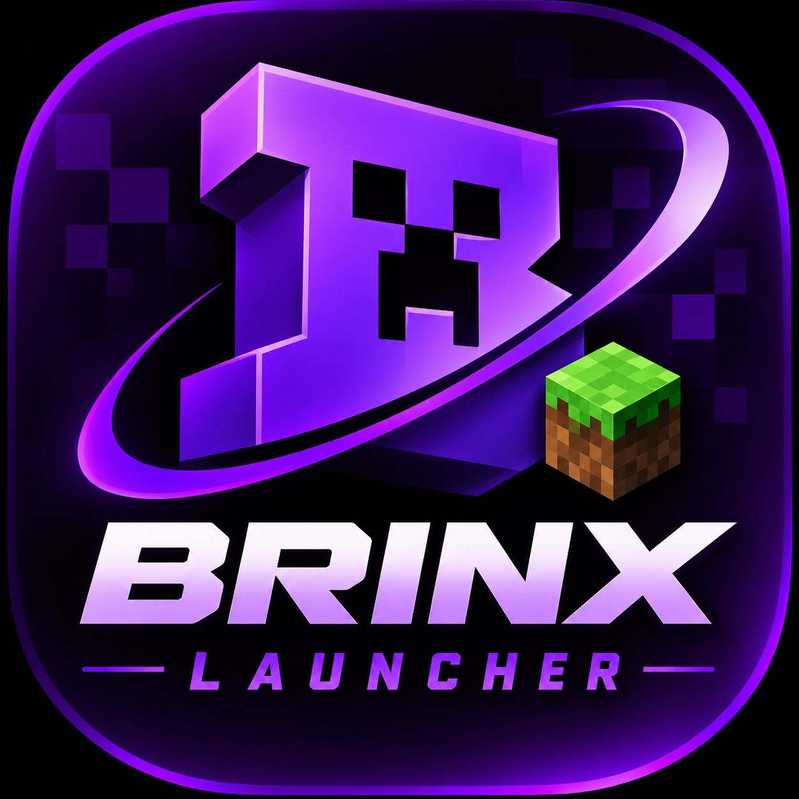

  

<h1 align="center">BRINX Launcher</h1>

  <strong>Your Minecraft. Your Experience.</strong>

  
  
  
  
  

  <a href="#features">Features</a> ·
  <a href="#screenshots">Screenshots</a> ·
  <a href="#compatibility">Compatibility</a> ·
  <a href="#roadmap">Roadmap</a> ·
  <a href="#contributing">Contributing</a>

---

BRINX Launcher is an Android launcher project focused on bringing the Minecraft Java Edition experience to mobile devices.

Built around a native Rust-based game engine, BRINX aims to deliver a practical mobile experience with customizable touch controls, resource packs, multiplayer support, and an expanding set of launcher features.

Android 9+ · Native Android · Vulkan · Touch Controls · Java Multiplayer

«BRINX is an unofficial community project. It is not affiliated with, endorsed by, or associated with Mojang or Microsoft.»

Features

Mobile gameplay

- Customizable touch controls.
- Joystick and D-pad control layouts.
- Touch aiming and crosshair aiming options.
- Adjustable button positions, sizes, and opacity.
- Optional Auto Sprint and 360-degree movement.
- Android keyboard and clipboard integration.
- Audio output and device vibration support.

Game engine

- Rust-based Minecraft Java engine.
- Vulkan rendering support.
- Resolution scaling and graphics options.
- Native Android integration.
- Multiplayer connectivity.

Content and customization

- Resource pack support.
- Resource downloads.
- ".hmod" mod importing and sandboxed execution on supported 64-bit builds.
- Game configuration and control customization.

Multiplayer

- Connect to supported Minecraft Java servers.
- Play with other Java Edition players where server compatibility permits.
- Server compatibility and anti-cheat behavior may vary.

Screenshots

  <i>BRINX Launcher gameplay screenshots will be added here.</i>

Mobile Gameplay| Touch Controls
"Gameplay screenshot" (docs/media/android/joystick-fox.png)| "Touch controls screenshot" (docs/media/android/dpad-river.png)

World Exploration| Multiplayer
"World screenshot" (docs/media/android/snow-landscape.png)| "Multiplayer screenshot" (docs/media/android/hypixel-arcade.png)

Compatibility

BRINX uses the Starling Android implementation of the Horizon Rust engine.

Current compatibility depends on the underlying engine and Android build.

Component| Support
Android| Android 9+
Graphics| Vulkan
Minecraft Java| 26.3 engine target
Resource packs| Supported
".hmod" mods| Supported on compatible 64-bit builds
".hnmod" mods| Not currently supported on Android
Fabric / Forge Java mods| Not directly supported
Multiplayer| Supported servers; compatibility varies

Important: Java-based Fabric and Forge mods cannot be assumed to work in this environment. Server and anti-cheat compatibility should be tested individually.

Roadmap

BRINX is being developed with a focus on expanding the mobile Minecraft experience.

Launcher

- [ ] Redesigned launcher interface.
- [ ] Game version management.
- [ ] Download manager.
- [ ] Multiple game profiles.
- [ ] Improved account management.

Mods and content

- [ ] Dedicated mod manager.
- [ ] Mod compatibility analysis.
- [ ] Mod library and discovery.
- [ ] Resource pack manager.
- [ ] Mod import improvements.
- [ ] AI-assisted mod porting research.

Customization

- [ ] Skin Studio.
- [ ] Cape Studio.
- [ ] Custom control layouts.
- [ ] Advanced graphics settings.
- [ ] Performance profiles.

Community

- [ ] Server browser.
- [ ] Friends system.
- [ ] Text messaging.
- [ ] Community features.

Roadmap items are planned features, not claims of current functionality.

Installation

Download and install a compatible BRINX Android release when one is published.

1. Open the Releases page.
2. Download the available APK.
3. Install it on a compatible Android device.
4. Follow the in-app setup instructions.

Note: Release and installation instructions will be updated as official BRINX builds become available.

Development

BRINX development focuses on Android integration, launcher functionality, performance, and user experience.

The underlying engine and Android implementation are based on the open-source Starling and Horizon projects. Their respective licenses and copyright notices remain applicable.

Useful upstream resources:

- "Starling" (https://github.com/JuanLuci/starling)
- "Starling unified repository" (https://github.com/starling-client/starling/tree/starling)
- "Horizon" (https://github.com/ludovic111/horizon)

Contributing

Contributions, bug reports, and suggestions are welcome.

You can help by:

- Reporting reproducible bugs.
- Testing on different Android devices.
- Improving Android compatibility.
- Working on launcher features.
- Improving documentation.

Before submitting code, please review the project's contribution guidelines and applicable upstream licenses.

Credits and Licensing

BRINX incorporates and builds upon open-source work from the Starling and Horizon projects.

Original copyright notices, applicable licenses, and third-party notices must be preserved. Dependencies remain under their respective licenses.

Minecraft is a trademark of Mojang Synergies AB. Minecraft assets and game files remain subject to their respective terms and licenses.

BRINX is an independent, unofficial project and is not affiliated with Mojang or Microsoft.

---

  <strong>BRINX Launcher</strong> 
  Built for Android. Designed for Minecraft.

